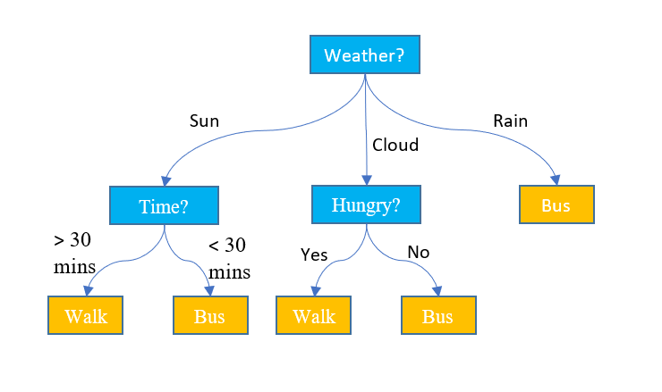
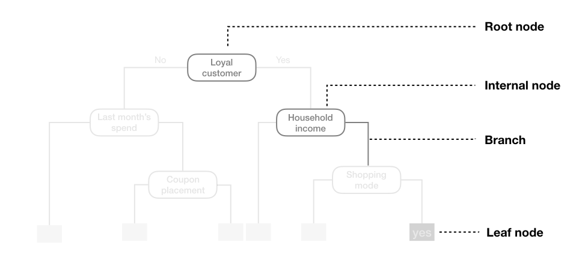
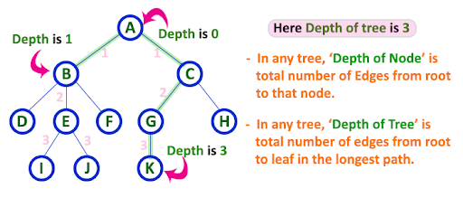

:::: {.slide}
::: {style="color: yellow"}
## Today's Lecture
:::
In today's lecture we will cover:

-   Introduction to decision trees
-   How a tree chooses its splits
-   Controlling the size of a tree
-   Limitations of a single tree
-   Two worked examples in R
::::

:::: {.slide}
::: {style="color: yellow"}
## A Visual Introduction to Machine Learning
:::

This interactive story by Stephanie Yee and Tony Chu builds a decision tree,
one split at a time, to tell homes in San Francisco from homes in New York. We
will scroll through it and talk through each step together.

<https://r2d3.us/visual-intro-to-machine-learning-part-1/>
::::

:::: {.slide}
::: {style="color: yellow"}
## Motivating Decision Trees
:::

An essay lands on your desk, and you suspect AI wrote it.

With a partner, take two minutes to write **three yes or no questions** about
the text that would help you decide. Put the most useful question first, and then choose one question to further refine each branch.

::: {style="color: lightgreen"}
Which question did you ask first, and why? What next?
:::
::::

:::: {.slide}
::: {style="color: yellow"}
## Decision Trees in Real Life
:::

Decision trees work the way people often make decisions: one step at a time,
if this, then that. Each example asks a short series of yes or no questions.

-   **Clinical screening**: PHQ-9 score above 10? → History of depression? →
    Recent major stressor? → elevated risk of depression
-   **College retention**: First semester GPA below 2.5? → Living on campus? →
    Missed more than 20% of classes? → returns next year or not
-   **Employee turnover**: Low job satisfaction? → Frequent overtime? → Less
    than 2 years on the job? → leaves or stays
-   **Relationship satisfaction**: High perceived support? → High conflict? →
    High financial stress? → high or low satisfaction
-   **Emergency room triage**: Difficulty breathing? → Oxygen saturation below
    90? → Age over 65? → risk category
::::

:::: {.slide}
::: {style="color: yellow"}
### More Examples
:::

-   **Spam filtering**: Suspicious link? → Known sender? → Words like "urgent"
    or "winner"? → spam or not
-   **Loan approval**: Income above a cutoff? → Debt to income ratio below a
    cutoff? → Prior defaults? → repays or not
-   **Customer churn**: Used the service in the last 30 days? → More than 2
    complaints? → Subscribed for over a year? → cancels or not
-   **Medical diagnosis**: Fever? → Cough? → Positive test? → illness category
-   **Animal identification**: Has feathers? → Can fly? → Lives mostly in
    water? → type of animal
::::

:::: {.slide}
::: {style="color: yellow"}
### What These Examples Show
:::

-   **The questions can depend on the path.** In clinical screening, which
    question comes second can depend on the answer to the first.
-   **No single feature has to decide.** A spam filter combines several weak
    clues.
-   **A harmless looking variable can stand in for something else.** In loan
    approval, ZIP code can act as a proxy for race and other protected
    characteristics.
-   **Real trees can be much bigger.** Medical trees may use dozens or hundreds
    of predictors, but the logic is the same.
::::


:::: {.slide}
::: {style="color: yellow"}
### What Makes It Machine Learning?
:::

In the umbrella tree, we wrote the questions and the cutoffs ourselves. A
decision tree **learns the questions and the cutoffs from the data**.

We do not tell the model to ask whether GPA is below 2.5, then whether
attendance is below 80%, then whether stress is above 7.

Instead, at every split the algorithm searches over questions of the form

$$
X_j < c
$$

It learns both **which variable** $X_j$ to ask about and **which cutoff** $c$
gives the best split.
::::


:::: {.slide}
::: {style="color: yellow"}
### Regression Versus Trees
:::

-   A regression model asks: **how much should each variable contribute?**
-   A decision tree asks: **what question should I ask next?**

Trees come in two kinds:

-   **Classification trees** predict a category, such as pass or fail.
-   **Regression trees** predict a continuous outcome, such as a final exam score.
::::

:::: {.slide}
::: {style="color: yellow"}
### Why Is It Called a Tree?
:::

The model looks like a flowchart:

-   You start at the **root**, the top of the tree.
-   You follow **branches** based on yes or no questions about the features.
-   You end at a **leaf**, which holds the prediction.

{width="700"}
::::

:::: {.slide}
::: {style="color: yellow"}
### Parts of a Decision Tree
:::

-   **Root node**: the top of the tree, where the first split happens. It
    contains all the data.
-   **Internal nodes**: points where the data are split on a feature.
-   **Branches**: the lines connecting nodes, one for each answer to a split.
-   **Leaf nodes**: the end points, where a prediction is made.
-   **Splits**: the conditions used to divide the data at each internal node.

{width="700"}
::::

:::: {.slide}
::: {style="color: yellow"}
### Back to the Essay
:::

Your three questions were a decision tree:

-   Each question is a **split**.
-   Your first question is the **root**, and the order of the rest is the
    structure of the tree.
-   Each final answer, AI or human, is a **leaf**.

Your questions already showed two things a tree does:

-   A question only helps if the text can answer it. In a model, the questions
    have to come from the features we measured.
-   You put your most useful question first. A tree also starts with the split
    that best separates the groups, then repeats inside each group.
::::

:::: {.slide}
::: {style="color: yellow"}
## How Do Decision Trees Work?
:::

The tree is built by asking the same question over and over:

::: {style="color: lightgreen"}
Which feature and split point best separate the data?
:::

-   For **classification**, we want splits that make each group as **pure** as
    possible, meaning mostly one class.
-   For **regression**, we want splits that make the outcomes within each group
    as similar as possible, usually measured with mean squared error.

The tree keeps splitting until:

-   the nodes are pure enough,
-   the tree reaches a maximum depth, or
-   there are too few observations left to split.
::::

:::: {.slide}
::: {style="color: yellow"}
### What is Purity?
:::

A node is **pure** if every observation in it belongs to the same class.

Suppose we want to predict whether students pass or fail a project from whether
they attend class:

```{r}
#| echo: false
students <- data.frame(
  Student  = c("A", "B", "C", "D", "E", "F"),
  Attended = c("Yes", "Yes", "Yes", "No", "No", "No"),
  Outcome  = c("Pass", "Pass", "Fail", "Fail", "Fail", "Pass")
)
students
```
::::

:::: {.slide}
::: {style="color: yellow"}
### Step 1: Impurity at the Root
:::

The root node holds all 6 students: 3 pass and 3 fail.

-   A node where all 20 students pass would be 100% pure.
-   A node split evenly between pass and fail, like this one, is as impure as a
    two class node can be.

A common measure of impurity is the **Gini impurity**: the chance that a randomly
chosen observation would be labeled wrong if we labeled it at random, using the
class proportions in the node.

$$
\text{Gini} = 1 - \left[\, p(\text{Pass})^2 + p(\text{Fail})^2 \,\right]
$$

or, for any number of classes,

$$
\text{Gini} = 1 - \sum_i p_i^2
$$

At the root, $\text{Gini} = 1 - (0.5^2 + 0.5^2) = 0.5$.
::::

:::: {.slide}
::: {style="color: yellow"}
### Step 2: Splitting on Attendance
:::

Now split the students by attendance and compute the Gini impurity of each group:

```{r}
#| echo: false
group_yes <- subset(students, Attended == "Yes")
group_no  <- subset(students, Attended == "No")

# Gini impurity of a set of class labels
gini <- function(x) {
  props <- table(x) / length(x)
  1 - sum(props^2)
}

c(Gini_Yes = gini(group_yes$Outcome), Gini_No = gini(group_no$Outcome))
```

-   The "Yes" group has 2 pass and 1 fail, so its Gini impurity is 0.444.
-   The "No" group has 2 fail and 1 pass, so its Gini impurity is 0.444.

Both groups are still impure, but each is purer than the root, at 0.5.
::::

:::: {.slide}
::: {style="color: yellow"}
### Other Measures of Impurity
:::

::: {style="color: lightblue"}
**Entropy**
:::

Measures the uncertainty in a node. Lower entropy means higher purity.

$$
\text{Entropy} = -\sum_i p_i \log_2(p_i)
$$

::: {style="color: lightblue"}
**Misclassification error**
:::

The share of observations that do not belong to the most common class in the
node.

$$
\text{Misclassification error} = 1 - \max_i \, p_i
$$

Like the Gini impurity, both measures help the tree choose splits that create
purer nodes.
::::

:::: {.slide}
::: {style="color: yellow"}
## How Purity Guides Splitting
:::

At every node, the tree faces the same question:

::: {style="color: lightgreen"}
Which feature should I split on, and at what threshold?
:::

To answer it, the tree tries every possible split on every feature. It picks the
split that makes the child nodes purer than the parent by the largest amount.

The next slides walk through that search one step at a time.
::::

:::: {.slide}
::: {style="color: yellow"}
### Steps 1 and 2: Parent and Child Impurity
:::

::: {style="color: lightblue"}
**Step 1: Impurity at the parent node**
:::

-   The parent node contains some mix of classes.
-   Compute its impurity, using Gini or entropy.

::: {style="color: lightblue"}
**Step 2: Impurity after a candidate split**
:::

For each feature and each possible split point:

-   Divide the data into child nodes.
-   Compute the impurity of each child node.
-   Take a weighted average of the child impurities, shown on the next slide.
::::

:::: {.slide}
::: {style="color: yellow"}
### The Impurity of a Split
:::

The impurity after a split is a weighted average of the child nodes:

$$
G_{\text{split}} = \sum_{j=1}^{m} \frac{N_j}{N} \, G_j
$$

where

-   $G_{\text{split}}$ is the impurity after the split,
-   $m$ is the number of child nodes,
-   $N_j$ is the number of observations in child node $j$,
-   $N$ is the number of observations in the parent node, and
-   $G_j$ is the impurity of child node $j$.

The split with the lowest $G_{\text{split}}$ is the best one.
::::

:::: {.slide}
::: {style="color: yellow"}
### Step 3: Impurity Reduction
:::

The quality of a split is how much it reduces impurity:

$$
\Delta G = G_{\text{parent}} - G_{\text{split}}
$$

where

-   $\Delta G$ is the reduction in impurity, also called the **information gain**,
-   $G_{\text{parent}}$ is the impurity of the parent node, and
-   $G_{\text{split}}$ is the weighted impurity after the split.

In the attendance example, both groups hold 3 of the 6 students, so
$G_{\text{split}} = \tfrac{3}{6}(0.444) + \tfrac{3}{6}(0.444) = 0.444$ and
$\Delta G = 0.5 - 0.444 = 0.056$.
::::

:::: {.slide}
::: {style="color: yellow"}
### Step 4: Choosing the Best Split
:::

-   The tree tries every feature and, for numeric features, every possible
    threshold.
-   The feature and threshold with the largest impurity reduction become the
    split.
-   The process repeats inside each child node until a stopping rule is met:
    -   a maximum depth,
    -   a minimum number of observations, or
    -   pure nodes.
::::

:::: {.slide}
::: {style="color: yellow"}
### Where Does the Splitting End?
:::

On your own, follow this process through to its natural conclusion. Suppose the
tree keeps choosing the best split, with no limits.

::: {style="color: lightgreen"}
1.  How will the splitting end?
2.  Will the tree predict the training sample perfectly?
3.  What are the consequences of that?
:::
::::

:::: {.slide}
::: {style="color: yellow"}
## How Low Can You Go?
:::

A tree can keep splitting until it classifies every training observation
correctly. At that point it is fitting noise, and it will predict new data
poorly. To prevent this, we limit how much the tree can grow:

-   **Maximum depth**: how many levels the tree can have.
-   **Minimum observations per leaf**: how few observations a leaf can hold.
-   **Minimum observations to split**: how many observations a node needs before
    it can be split.
-   **Pruning**: removing branches that add little predictive power.

{width="600"}
::::

:::: {.slide}
::: {style="color: yellow"}
### Early Stopping
:::

Early stopping rules stop the tree before it grows large enough to overfit.

::: {style="color: lightblue"}
**Maximum depth**
:::

A shallower tree is less likely to overfit. We might allow 5 or 10 levels.

-   Too shallow, and the tree may underfit: more bias, less variance.
-   Too deep, and it may overfit: less bias, more variance.

::: {style="color: lightblue"}
**Minimum observations per leaf**
:::

-   Allowing a single observation in a leaf invites overfitting.
-   Requiring at least 10 or 20 per leaf helps the tree generalize.

::: {style="color: lightblue"}
**Minimum impurity decrease**
:::

-   Only split when the split reduces impurity by a meaningful amount.
::::

:::: {.slide}
::: {style="color: yellow"}
### Pruning
:::

Pruning removes branches that do not add much predictive power. There are two
approaches.

::: {style="color: lightblue"}
**Post-pruning**
:::

Grow the full tree, then remove the branches that do not improve performance on
validation data.

::: {style="color: lightblue"}
**Pre-pruning**
:::

Add a penalty for the size of the tree to the quantity it minimizes.

-   A smaller penalty allows a larger tree.
-   A larger penalty forces a smaller tree.

As with regularization, we fit trees across a range of penalty values and use
cross validation to pick the value that predicts new data best.
::::

:::: {.slide}
::: {style="color: yellow"}
### The Complexity Parameter `cp`
:::

In the `rpart` package, which we use below, the complexity parameter `cp`
controls how large a tree can grow. It is the main tool for balancing the size
of a tree against how well it generalizes.

-   Each split must reduce the lack of fit by at least `cp` times the error.
-   Splits that fall short are pruned away.
-   A **large** `cp` gives a smaller tree: simpler, more bias, less variance.
-   A **small** `cp` gives a larger tree: more complex, less bias, more variance.
::::

:::: {.slide}
::: {style="color: yellow"}
### The Cost Complexity Criterion
:::

`rpart` fits and prunes trees with **cost complexity pruning**, also called
weakest link pruning. It minimizes

$$
C_{\alpha}(T) = R(T) + \alpha \, |T|
$$

where

-   $R(T)$ is the error of tree $T$, summed over its leaves,
-   $|T|$ is the number of leaves, and
-   $\alpha \ge 0$ is the penalty for each leaf. In `rpart`, `cp` plays this
    role.

This has the same form as the loss in regularized regression: an error term plus
a penalty for complexity.
::::

:::: {.slide}
::: {style="color: yellow"}
### What is $R(T)$?
:::

$R(T)$ depends on the task. It is always a sum over the leaves $t$ of the tree.

::: {style="color: lightblue"}
**Regression trees** (`method = "anova"`)
:::

The squared error around each leaf's mean:

$$
R(T) = \sum_{t \in \text{leaves}(T)} \; \sum_{i \in t} \left(y_i - \bar{y}_t\right)^2,
\qquad
\bar{y}_t = \frac{1}{N_t} \sum_{i \in t} y_i
$$

::: {style="color: lightblue"}
**Classification trees** (`method = "class"`)
:::

The number of misclassified observations in each leaf:

$$
R(T) = \sum_{t \in \text{leaves}(T)} N_t \left(1 - \max_k \, p_{tk}\right),
\qquad
p_{tk} = \frac{1}{N_t} \sum_{i \in t} \mathbf{1}\{y_i = k\}
$$
::::

:::: {.slide}
::: {style="color: yellow"}
## Limitations of a Single Tree
:::

::: {style="color: lightblue"}
**Overfitting**
:::

-   A tree can keep splitting until every leaf is pure, fitting the training
    data perfectly.
-   That captures noise, and the tree generalizes poorly.

::: {style="color: lightblue"}
**High variance**
:::

-   Small changes in the training data can produce a very different tree.
-   That makes a single tree unreliable.
::::

:::: {.slide}
::: {style="color: yellow"}
### More Limitations
:::

::: {style="color: lightblue"}
**Bias toward features with many levels**
:::

-   Features with many unique values, such as IDs or zip codes, offer many
    possible splits and can dominate.
-   The tree may favor them even when they are not meaningful.

::: {style="color: lightblue"}
**Greedy splitting**
:::

-   Each split is the best one available at that step, which is only a local
    optimum.
-   The tree can miss a better overall structure.

Bagging, random forests, and boosting, which come next, address the high
variance by combining many trees.
::::

:::: {.slide}
::: {style="color: yellow"}
## Implementation in R
:::

In R we use the `rpart` package, which implements **CART** (Classification and
Regression Trees), the most widely used algorithm for building decision trees.

As with the earlier models, we fit it through `caret::train()`, here with
`method = "rpart"`.
::::

:::: {.slide}
::: {style="color: yellow"}
## Load the Required Packages
:::

```{r}
library(rpart)      # decision trees (CART)
library(caret)      # train(), cross validation, and performance metrics
library(rsample)    # splitting data into training and test sets
library(tidyverse)  # data manipulation and plots
library(recipes)    # preprocessing recipes
library(rattle)     # fancyRpartPlot() for drawing trees
library(titanic)    # the Titanic data
library(psych)      # describe() for descriptives
```
::::

:::: {.slide}
::: {style="color: yellow"}
## The Personality Data
:::

-   **Source**: the Big Five personality test data from Kaggle, collected online
    by Open Psychometrics. We use 1,000 respondents.
-   **Items**: 50 statements, 10 for each of the Big Five traits: extraversion
    (`EXT`), emotional stability (`EST`), agreeableness (`AGR`),
    conscientiousness (`CSN`), and openness (`OPN`).
-   **Scale**: each statement was rated from 1 (disagree) to 5 (agree), with 3
    as neutral. A 0 means the item was skipped.
-   **Our version**: to practice preprocessing, 20 items were recoded to 0 and 1,
    and 10 to Low, Medium, and High. The other 20 keep the original scale.
-   **Target**: `OPN8`, "I use difficult words," coded 1 for strongly agree and 0
    otherwise. 44% of respondents are 1s.
::::

:::: {.slide}
::: {style="color: yellow"}
## Personality Example
:::

We will predict `OPN8` from the other personality items.

-   `OPN8` records whether a respondent strongly agrees (1) or does not strongly
    agree (0) with "I use difficult words."
-   The predictors are the other 49 items, prepared the same way as before.

```{r}
data <- read.csv("data/data-final-shuffled.csv")

# items coded 0 and 1, and items stored as text, are categories
dichotomous_vars <- colnames(data)[sapply(data, max) == 1]
character_vars   <- colnames(data)[sapply(data, class) == "character"]
cat_vars         <- c(character_vars, dichotomous_vars)
data[cat_vars]   <- lapply(data[cat_vars], as.factor)

target <- "OPN8"
data   <- data[!is.na(data[, target]), ]

set.seed(123)
split      <- initial_split(data, prop = 0.7, strata = target)
data_train <- training(split)
data_test  <- testing(split)
```
::::

:::: {.slide}
::: {style="color: yellow"}
### The Recipe
:::

The recipe follows the pattern from the Workflow page: impute missing values with
bagged trees, then dummy code the factors.

```{r}
formula_string <- as.formula(paste(target, "~ ."))

blueprint <- recipe(formula_string, data = data_train) %>%
  step_impute_bag(all_predictors()) %>%
  step_dummy(all_factor_predictors(), one_hot = FALSE)
```

Trees do not need centered or scaled predictors, because a split only depends on
the order of the values.

`one_hot = FALSE` drops one level of each factor as the reference category.
Regression needs that, because a full set of dummy columns is redundant with the
intercept. A tree has no intercept, so it does not need it. We keep it so the
recipe matches the earlier lectures.
::::

:::: {.slide}
::: {style="color: yellow"}
### Tuning `cp` with Cross Validation
:::

We tune `cp` with 10 fold cross validation. `tuneLength = 10` asks `caret` to try
10 values of `cp`, and `metric = "Kappa"` picks the one with the best Kappa,
which corrects accuracy for the agreement we would expect by chance.

```{r}
#| cache: true
set.seed(15)

cv_model_1 <- train(
  blueprint,
  data       = data_train,
  method     = "rpart",
  metric     = "Kappa",
  trControl  = trainControl(method = "cv", number = 10),
  tuneLength = 10
)
```
::::

:::: {.slide}
::: {style="color: yellow"}
### Cross Validation Results
:::

```{r}
cv_model_1
```
::::

:::: {.slide}
::: {style="color: yellow"}
### Kappa Across Values of `cp`
:::

```{r}
ggplot(cv_model_1)
```

Kappa is highest at a `cp` of about 0.023, which gives a tree with 4 leaves.
::::

:::: {.slide}
::: {style="color: yellow"}
### The Final Tree as Text
:::

```{r}
cv_model_1$finalModel
```
::::

:::: {.slide}
::: {style="color: yellow"}
### Plotting the Tree
:::

```{r}
fancyRpartPlot(cv_model_1$finalModel, sub = "")
```

Each box is a node:

-   The top line is the predicted class.
-   The middle line gives the share of each class in the node, 0 first and then 1.
-   The bottom line is the percentage of the training data that reaches the node.

The split rule is printed below each box. Respondents who meet it go left.
::::

:::: {.slide}
::: {style="color: yellow"}
### Reading the Tree: The First Split
:::

```{r}
#| echo: false
#| fig-width: 7
#| fig-height: 3.6
#| out-width: "60%"
#| fig-align: center
# the tree cut back to its first split
fancyRpartPlot(snip.rpart(cv_model_1$finalModel, toss = 3), sub = "")
```

-   At the root, the tree predicts `OPN8 = 0` with probability 0.56. That is the
    share of training respondents who do not strongly agree with "I use difficult
    words."
-   The first split is on `OPN1`, "I have a rich vocabulary."
-   Respondents who scored 3 or lower on `OPN1` (`OPN1 < 3.5`) go left, to a leaf
    with 38% of the sample. In that leaf, 0.87 have `OPN8 = 0`.
-   Respondents who scored 4 or 5 go right. In that node, 0.64 have `OPN8 = 1`.
::::

:::: {.slide}
::: {style="color: yellow"}
### Reading the Tree: The Second Split
:::

```{r}
#| echo: false
#| fig-width: 7
#| fig-height: 3.6
#| out-width: "60%"
#| fig-align: center
# the tree cut back to its first two splits
fancyRpartPlot(snip.rpart(cv_model_1$finalModel, toss = 6), sub = "")
```

The right branch splits on `OPN1` again:

-   Respondents who scored 5 (`OPN1 >= 4.5`) go to a leaf with 27% of the sample,
    where 0.78 have `OPN8 = 1`.
-   Respondents who scored 4 go to a node with 35% of the sample, where 0.53
    have `OPN8 = 1`. That node splits once more.
::::

:::: {.slide}
::: {style="color: yellow"}
### Reading the Tree: The EXT9 Split
:::

```{r}
#| echo: false
#| fig-width: 7
#| fig-height: 4.2
#| out-width: "60%"
#| fig-align: center
fancyRpartPlot(cv_model_1$finalModel, sub = "")
```

Respondents who scored 4 on `OPN1` split on `EXT9_X1`, the dummy column for
`EXT9`, "I don't mind being the center of attention."

-   Respondents who do not endorse `EXT9` (`EXT9_X1 < 0.5`) go to a leaf with 22%
    of the sample. The tree predicts `OPN8 = 0`, with probability 0.55.
-   Respondents who endorse `EXT9` (`EXT9_X1 >= 0.5`) go to a leaf with 13% of
    the sample. The tree predicts `OPN8 = 1`, with probability 0.66.
::::

:::: {.slide}
::: {style="color: yellow"}
### How Well Does the Tree Predict?
:::

The test set gives the verdict, and we use it once.

```{r}
pred_class <- predict(cv_model_1, newdata = data_test)

confusionMatrix(
  data      = relevel(pred_class, ref = "1"),
  reference = relevel(data_test[, target], ref = "1")
)
```

The tree classifies 74% of the test respondents correctly. It catches 65% of
those who strongly agree (sensitivity) and 81% of those who do not
(specificity).

Always guessing 0 would already be right 56% of the time. Kappa corrects for
that: it is 0 for guessing, and 0.47 for this tree.
::::

:::: {.slide}
::: {style="color: yellow"}
## Titanic Example
:::

The `titanic` package includes the passenger list from the Titanic. We predict
whether each passenger survived.

```{r}
titanic_train <- titanic::titanic_train
```

The features we use:

-   `Survived`: whether the passenger survived (1) or not (0). This is the target.
-   `Pclass`: passenger class (1st, 2nd, 3rd).
-   `Sex`: sex of the passenger.
-   `Age`: age in years.
-   `SibSp`: number of siblings or spouses aboard.
-   `Parch`: number of parents or children aboard.
-   `Fare`: ticket fare.
-   `Embarked`: port of embarkation (C = Cherbourg, Q = Queenstown,
    S = Southampton).
::::

:::: {.slide}
::: {style="color: yellow"}
### Descriptives
:::

```{r}
describe(titanic_train)
```
::::

:::: {.slide}
::: {style="color: yellow"}
### Fitting the Tree
:::

Drop the columns we will not use, set the factors, build the recipe, and tune
`cp`. `Survived` is a factor, so this is a classification tree.

```{r}
#| cache: true
titanic_train$PassengerId <- NULL
titanic_train$Name        <- NULL
titanic_train$Ticket      <- NULL
titanic_train$Cabin       <- NULL
titanic_train$Survived    <- as.factor(titanic_train$Survived)
titanic_train$Sex         <- as.factor(titanic_train$Sex)

blueprint_titanic <- recipe(Survived ~ ., data = titanic_train) %>%
  step_impute_bag(all_predictors()) %>%
  step_dummy(all_factor_predictors(), one_hot = FALSE)

set.seed(559)

cv_model_titanic <- train(
  blueprint_titanic,
  data       = titanic_train,
  method     = "rpart",
  metric     = "Kappa",
  trControl  = trainControl(method = "cv", number = 10),
  tuneLength = 20
)
```
::::

:::: {.slide}
::: {style="color: yellow"}
### Kappa Across Values of `cp`
:::

```{r}
ggplot(cv_model_titanic)
```
::::

:::: {.slide}
::: {style="color: yellow"}
### The Final Tree
:::

```{r}
fancyRpartPlot(cv_model_titanic$finalModel, sub = "")
```
::::

:::: {.slide}
::: {style="color: yellow"}
### Reading the Titanic Tree: The First Split
:::

```{r}
#| echo: false
#| fig-width: 7
#| fig-height: 3.6
#| out-width: "60%"
#| fig-align: center
# the tree cut back to its first split
fancyRpartPlot(snip.rpart(cv_model_titanic$finalModel, toss = c(2, 3)), sub = "")
```

-   At the root, 0.62 of passengers died, so the tree predicts `Survived = 0`.
-   The first split is on `Sex_male`, the dummy column for `Sex`.
-   Men (`Sex_male >= 0.5`) go left. They are 65% of passengers, and only 0.19
    survived.
-   Women go right. They are 35% of passengers, and 0.74 survived.
::::

:::: {.slide}
::: {style="color: yellow"}
### Reading the Titanic Tree: Men
:::

```{r}
#| echo: false
#| fig-width: 7
#| fig-height: 4.2
#| out-width: "60%"
#| fig-align: center
# the men's branch, cut back after its first two splits
fancyRpartPlot(snip.rpart(cv_model_titanic$finalModel, toss = c(3, 5, 8, 9)), sub = "")
```

Men are split by age, then by class:

-   Boys younger than 6.5 (`Age < 6.5`) are 3% of passengers, and 0.67 survived.
-   Older males are 62% of passengers, and 0.17 survived. They split on class:
    -   Second or third class (`Pclass >= 1.5`): 49% of passengers, 0.12 survived.
    -   First class: 13% of passengers, 0.36 survived.
::::

:::: {.slide}
::: {style="color: yellow"}
### Reading the Titanic Tree: Women
:::

```{r}
#| echo: false
#| fig-width: 7
#| fig-height: 3.6
#| out-width: "60%"
#| fig-align: center
# the women's branch, cut back after its first split
fancyRpartPlot(snip.rpart(cv_model_titanic$finalModel, toss = c(2, 6)), sub = "")
```

Women are split by class:

-   First or second class (`Pclass < 2.5`): 19% of passengers, 0.95 survived.
-   Third class: 16% of passengers, 0.50 survived. The tree keeps splitting this
    group on fare and age.

Together, the first few splits recover "women and children first," and show how
much class mattered as well.
::::

:::: {.slide}
::: {style="color: yellow"}
### Performance on the Training Data
:::

`titanic_train` is the only Titanic data with `Survived` recorded, so here we
score the tree on the same passengers it was trained on. That overstates how well
it would do on new passengers.

```{r}
pred_class <- predict(cv_model_titanic, newdata = titanic_train)

confusionMatrix(
  data      = relevel(pred_class, ref = "1"),
  reference = relevel(titanic_train[, "Survived"], ref = "1")
)
```
::::

:::: {.slide}
::: {style="color: yellow"}
## Wrapping Up
:::

A single decision tree is easy to explain: anyone can follow the questions from
the root to a leaf. It also handles numeric and categorical predictors, needs no
scaling, and finds interactions on its own.

But a single tree has real problems:

-   **It overfits.** Left alone, it splits until it fits the training data
    perfectly.
-   **It is unstable.** Small changes can produce a very different tree. Even the
    size of our personality tree depended on how the folds were drawn: across
    100 seeds, cross validation chose trees with anywhere from 2 to 17 leaves.
-   **It is greedy.** Each split is the best one at that step, not the best tree
    overall.

::: {style="color: lightgreen"}
Coming next: what if, instead of trusting one tree, we grew hundreds of them on
slightly different samples and let them vote?
:::

That is the idea behind **bagging**, **random forests**, and **boosting**.
::::
