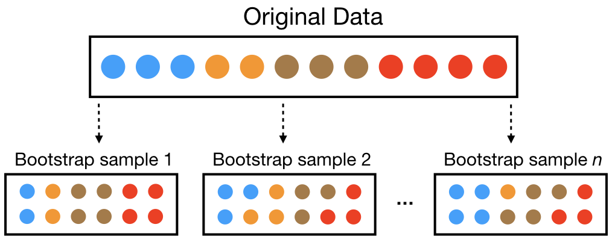

:::: {.slide}
::: {style="color: yellow"}
## Today's Lecture
:::
In today's lecture we will cover:

-   Why one tree is not enough
-   Bootstrapping
-   Bagging
-   Bagging in R
::::

:::: {.slide}
::: {style="color: yellow"}
## From One Tree to Many
:::

The decision tree lecture ended with a problem: a single tree has **high
variance**. Small changes in the training data can produce a very different
tree, which leads to overfitting and poor predictions on new data.

**Bagging**, short for **b**ootstrap **agg**regat**ing**, reduces that variance:

-   Build many versions of the same model, each on a slightly different training
    set.
-   Combine their predictions into one.
::::

:::: {.slide}
::: {style="color: yellow"}
## One Sample, Many Possible Samples
:::

A psychologist collects data from 150 college students and predicts their
depressive symptoms from sleep, stress, social support, and exercise. They fit
a decision tree, and the tree splits first on sleep.

::: {style="color: lightgreen"}
-   Would another sample of 150 students produce the same tree?
-   Would sleep still be the first split?
-   How could we find out without recruiting another 150 students?
:::
::::

:::: {.slide}
::: {style="color: yellow"}
### What Depends on the Sample?
:::

-   We know what the model learned from this sample.
-   We do not know how much of that depends on the particular people who
    happened to take part.
-   Classical statistics answers this with standard errors, confidence
    intervals, and sampling distributions. For complicated models, such as a
    tree, the math for these is hard or unknown.
-   The bootstrap takes a different route: simulate collecting new samples,
    using only the data we already have.
::::

:::: {.slide}
::: {style="color: yellow"}
### A Brief History of the Bootstrap
:::

-   In 1979, Stanford statistician Bradley Efron published [Bootstrap Methods:
    Another Look at the Jackknife](https://doi.org/10.1214/aos/1176344552). He
    is the same Efron from the baseball example in the regularization lecture.
-   Before then, learning how much an estimate would vary across samples meant
    deriving its sampling distribution by hand, or relying on a large sample
    approximation. That works for a mean or a regression slope, and gets hard
    for complicated estimates.
-   Efron's idea was simple: treat the sample as a stand in for the population,
    draw new samples from it, and repeat the calculation. It works for a very
    wide range of problems.
-   Related ideas came earlier, such as the jackknife of Maurice Quenouille and
    John Tukey. Fast computers made Efron's approach practical.
-   The name comes from "pulling yourself up by your own bootstraps": learning
    about the population using only the sample.

The bootstrap moved part of statistical inference from something we derive with
math to something we compute. Machine learning is built on that same shift.
::::

:::: {.slide}
::: {style="color: yellow"}
## What is Bootstrapping?
:::

**Bootstrapping** creates new datasets by sampling the original data **with
replacement**.

-   Each bootstrap sample has the same number of rows as the original.
-   Some observations appear more than once, and others not at all.

{width="700"}
::::

:::: {.slide}
::: {style="color: yellow"}
### Out of Bag Observations
:::

-   On average, a bootstrap sample contains about 63.2% of the original
    observations.
-   The rest, about 36.8%, are **out of bag (OOB)**.
-   A model can be trained on the bootstrap sample and checked on its out of bag
    observations, which act as a free validation set. Random forests, in the
    next lecture, use this.

Why 63.2%? Each draw misses a given observation with probability $1 - 1/n$, so
after $n$ draws the observation is left out with probability

$$
\left(1 - \frac{1}{n}\right)^{n} \approx e^{-1} \approx 0.368
$$
::::

::::: {.slide}
::: {style="color: yellow"}
### Bootstrapping Example
:::

The same 12 students, sampled with replacement. ID 3 appears twice and ID 11 is
left out, so ID 11 is out of bag. A typical sample would leave out about 4.

:::: {.two-col .compact}
::: {}
**Original data**

| ID  | StudyHours | Attendance | Passed |
|-----|------------|------------|--------|
| 1   | 2.0        | Low        | No     |
| 2   | 3.5        | Low        | No     |
| 3   | 4.0        | Low        | No     |
| 4   | 4.5        | Med        | No     |
| 5   | 5.0        | Med        | No     |
| 6   | 5.5        | Med        | Yes    |
| 7   | 6.0        | Med        | Yes    |
| 8   | 6.5        | High       | Yes    |
| 9   | 7.0        | High       | Yes    |
| 10  | 7.5        | High       | Yes    |
| 11  | 8.0        | High       | Yes    |
| 12  | 8.5        | High       | Yes    |
:::

::: {}
**One bootstrap sample**

| ID  | StudyHours | Attendance | Passed |
|-----|------------|------------|--------|
| 3   | 4.0        | Low        | No     |
| 5   | 5.0        | Med        | No     |
| 7   | 6.0        | Med        | Yes    |
| 2   | 3.5        | Low        | No     |
| 9   | 7.0        | High       | Yes    |
| 12  | 8.5        | High       | Yes    |
| 1   | 2.0        | Low        | No     |
| 6   | 5.5        | Med        | Yes    |
| 4   | 4.5        | Med        | No     |
| 8   | 6.5        | High       | Yes    |
| 10  | 7.5        | High       | Yes    |
| 3   | 4.0        | Low        | No     |
:::
::::
:::::

:::: {.slide}
::: {style="color: yellow"}
### Why Bootstrap Decision Trees?
:::

-   Each tree is trained on a different bootstrap sample, so the trees differ.
-   To predict, we combine the trees:
    -   for **classification**, by majority vote,
    -   for **regression**, by averaging.
-   Combining smooths out the quirks of the individual trees and reduces
    variance.
-   Bagging works best with deep, unpruned trees. Each one has low bias and high
    variance, and averaging removes much of the variance.
::::

:::: {.slide}
::: {style="color: yellow"}
## Bagging in R
:::

We return to the personality example from the decision tree lecture: predicting
`OPN8`, "I use difficult words," from the other 49 items.

-   First, we refit the single tree from that lecture as a benchmark.
-   Then we bag 100 trees and compare.
::::

:::: {.slide}
::: {style="color: yellow"}
## Load the Required Packages
:::

```{r}
library(caret)    # train() and confusionMatrix()
library(rpart)    # decision trees
library(recipes)  # preprocessing recipes
library(rsample)  # splitting data into training and test sets
library(ipred)    # bagging()
```
::::

:::: {.slide}
::: {style="color: yellow"}
### The Single Tree from Last Lecture
:::

This refits the tree from the decision tree lecture, with the same data, split,
seed, and settings. The code is hidden because it matches that lecture.

```{r}
#| echo: false
#| cache: true
data <- read.csv("data/data-final-shuffled.csv")

dichotomous_vars <- colnames(data)[sapply(data, max) == 1]
character_vars   <- colnames(data)[sapply(data, class) == "character"]
cat_vars         <- c(character_vars, dichotomous_vars)
data[cat_vars]   <- lapply(data[cat_vars], as.factor)

target <- "OPN8"
data   <- data[!is.na(data[, target]), ]

set.seed(123)
split      <- initial_split(data, prop = 0.7, strata = target)
data_train <- training(split)
data_test  <- testing(split)

blueprint <- recipe(as.formula(paste(target, "~ .")), data = data_train) %>%
  step_impute_bag(all_predictors()) %>%
  step_dummy(all_factor_predictors(), one_hot = FALSE)

set.seed(15)

cv_model_1 <- train(
  blueprint,
  data       = data_train,
  method     = "rpart",
  metric     = "Kappa",
  trControl  = trainControl(method = "cv", number = 10),
  tuneLength = 10
)
```

```{r}
pred_tree <- predict(cv_model_1, newdata = data_test)

confusionMatrix(
  data      = relevel(pred_tree, ref = "1"),
  reference = relevel(data_test[, target], ref = "1")
)
```
::::

:::: {.slide}
::: {style="color: yellow"}
### Bagging with `ipred`
:::

These data have no missing values, so the bagged trees can use the formula
directly, without a recipe.

```{r}
# make the bootstrap samples reproducible
set.seed(123)

cv_bag1 <- bagging(
  formula = OPN8 ~ .,
  data    = data_train,
  nbagg   = 100,
  coob    = TRUE,
  control = rpart.control(minsplit = 2, cp = 0)
)
```

-   `nbagg = 100` grows 100 trees, each on its own bootstrap sample.
-   `coob = TRUE` estimates the error from the out of bag observations.
-   `rpart.control(minsplit = 2, cp = 0)` grows each tree as deep as it can, with
    no pruning.
::::

:::: {.slide}
::: {style="color: yellow"}
### The Out of Bag Error
:::

```{r}
cv_bag1
```

The out of bag error is 0.28, so the bagged trees correctly classify about
72% of the observations they did not see. We got that estimate without
touching the test set.
::::

:::: {.slide}
::: {style="color: yellow"}
### Test Set Performance
:::

```{r}
pred_bag <- predict(cv_bag1, newdata = data_test)

confusionMatrix(
  data      = relevel(pred_bag, ref = "1"),
  reference = relevel(data_test[, target], ref = "1")
)
```
::::

:::: {.slide}
::: {style="color: yellow"}
### Comparing the Two Models
:::

| Test set    | Single tree | Bagged trees |
|-------------|------------:|-------------:|
| Accuracy    |       0.741 |        0.774 |
| Kappa       |       0.469 |        0.543 |
| Sensitivity |       0.654 |        0.752 |
| Specificity |       0.810 |        0.792 |

-   Bagging raises Kappa from 0.47 to 0.54.
-   Each bagged tree has more than 80 leaves. On its own, any one of them would
    overfit badly. Averaging 100 of them does not.
-   The cost: there is no longer a single tree to read.
::::

:::: {.slide}
::: {style="color: yellow"}
## Wrapping Up
:::

-   Bagging grows many deep trees on bootstrap samples and lets them vote.
    Averaging reduces variance: here, test Kappa rose from 0.47 to 0.54.
-   The out of bag observations give a built in estimate of error.
-   The cost is interpretability. No one can read 100 trees with 80 leaves each.
-   One problem remains: all 100 trees split first on `OPN1`. Trees that look
    alike make similar mistakes, which limits how much averaging can help.

::: {style="color: lightgreen"}
Coming next: random forests make the trees less alike by letting each split
consider only a random subset of the predictors.
:::
::::
