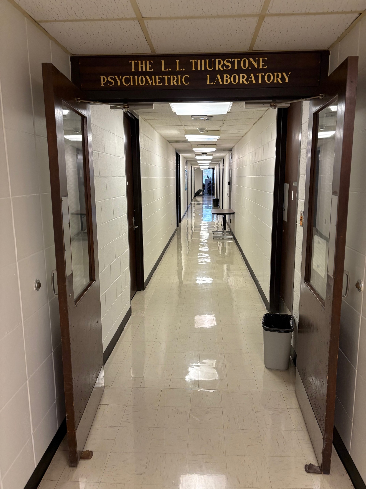
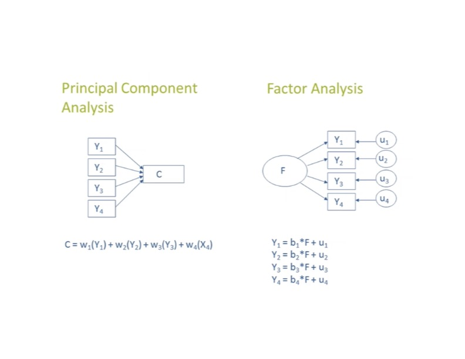

:::: {.slide}
::: {style="color: yellow"}
## Today's Lecture
:::
In today's lecture we will cover:

-   From clustering people to summarizing variables
-   Why psychologists reduce dimensions
-   A brief history: from questionnaires to components
-   PCA and factor analysis
-   What PCA does, on the fifty Big Five items
-   The road to the Big Five
-   PCA in R with `prcomp()`
-   Choosing the number of components
-   Scores, loadings, and rotation
-   Using, checking, and reporting a PCA
::::

:::: {.slide}
::: {style="color: yellow"}
## Where We Have Been
:::

The last two lectures were about clustering. K-means and hierarchical
clustering both took $n$ people measured on $p$ variables and sorted the
people into groups.

That was **person-centered**. The output was one new column: a group label
for each person.

::: {style="color: lightgreen"}
Today we work on the columns instead of the rows.
:::

Principal components analysis (PCA) takes the same kind of data and builds a
small number of new variables that carry most of the information in the
original $p$. The output is a few new columns, with a weight for every
original variable.
::::

:::: {.slide}
::: {style="color: yellow"}
## Two Kinds of Unsupervised Learning
:::

| | Clustering | Dimension reduction |
|----|----|----|
| **Works on** | Rows (people) | Columns (variables) |
| **Asks** | Are there groups of similar people? | Can a few new variables stand in for many? |
| **Output** | A group label for each person | A score for each person on each new variable, and a loading for each old variable |
| **Methods** | K-means, hierarchical, mixture models | PCA, factor analysis, autoencoders |

Both are unsupervised. There is still no $y$, so there is still no test set
error. We judge a PCA by how much variance it keeps, how stable it is, and
whether the components are useful.
::::

:::: {.slide}
::: {style="color: yellow"}
## Why Psychologists Reduce Dimensions
:::

-   **Many correlated items.** A questionnaire has 50 items, but nobody
    believes it measures 50 different things. A few summary scores are easier
    to use and easier to explain.
-   **Too many predictors.** Regression and clustering struggle when
    predictors are highly correlated or when there are many of them relative
    to the sample size.
-   **Noise.** The last few components mostly carry random error. Keeping only
    the first few can filter some of it out.
-   **Pictures.** Two components can be plotted. Fifty variables cannot.
-   **Structure.** Which items go together? That question built the Big Five.

::: {style="color: lightgreen"}
PCA returns components whether or not they mean anything. Deciding whether
they do is the hard part, just as it was with clusters.
:::
::::

:::: {.slide}
::: {style="color: yellow"}
## Questionnaires Made the Problem
:::

On the first day we saw that psychology has had more data than it could
handle since the 1890s, and that questionnaires were the reason.

-   G. Stanley Hall circulated more than 200 questionnaires between 1894 and
    1915, on topics from anger to dolls. By 1896 over one hundred thousand
    had come back, some of them forty or fifty pages long.
-   Hall wanted "a composite photograph" of each construct. His problem was
    getting there: "When these returns come in, one at first feels helpless
    before them" (Hall, 1897, quoted in Young, 2018).
-   The First World War brought mass testing of army recruits, tests with
    restricted answer sets, and new statistical techniques. Those fed
    Thurstone's and Likert's scaled questionnaires, including the Likert
    scale (Likert, 1932).

::: {style="color: lightgreen"}
Hall wanted a composite photograph of each construct. A principal component
is one way to take it: a weighted combination of many items, chosen by a
rule.
:::
::::

:::: {.slide}
::: {style="color: yellow"}
### From Answers to a Correlation Matrix
:::

Scaled answers changed what could be computed.

-   Once every answer is a number on the same scale, every pair of items has
    a correlation. Fifty items give 1,225 of them.
-   The correlation matrix is the raw material. Items that go together
    correlate, and items that do not stay near zero.
-   The questions psychologists began asking of that matrix are the questions
    PCA answers. How many things does this questionnaire measure? Which items
    belong to which? How should a person's answers be combined into a score?

::: {style="color: lightgreen"}
The other half of the first day's story comes along too. Young (2018) calls
it the move from thick to thin description: a person's experience becomes a
number on a scale. A component score goes one step further and turns fifty
of those numbers into one.
:::
::::

:::: {.slide}
::: {style="color: yellow"}
### One Factor or Several
:::

::: {style="color: lightblue"}
**1904: one general factor**
:::

-   Charles Spearman noticed that scores on different mental tests were all
    positively correlated, and argued they shared one underlying factor,
    which he called **g**.
-   Mathematically he was pulling one dominant dimension out of a correlation
    matrix, close to what the first principal component does.

::: {style="color: lightblue"}
**1930s: several factors and simple structure**
:::

-   Louis Thurstone argued for several broad abilities instead of one:
    verbal, spatial, numerical, and so on.
-   He showed that the axes through a correlation matrix can be turned
    without changing how much variance they explain, and chose the position
    where each test loads on one factor. He called that pattern **simple
    structure**.
-   One factor or several was partly a question of where the axes sat. That
    choice comes back later today as rotation.
::::

:::: {.slide}
::: {style="color: yellow"}
### Thurstone at Carolina
:::

Thurstone moved to UNC in 1952 and founded the Psychometric Laboratory
here. It now carries his name and is still on the second floor of Davie
Hall.

{fig-align="center"}
::::

:::: {.slide}
::: {style="color: yellow"}
## A Brief History: PCA Takes Shape
:::

::: {style="color: lightblue"}
**1933: principal components formalized**
:::

-   Harold Hotelling defined principal components in the modern sense: new
    uncorrelated variables, each a weighted combination of the originals,
    ordered so that each explains as much of the remaining variance as
    possible.
-   Karl Pearson had described the geometry in 1901, as the line of closest
    fit to a cloud of points.

::: {style="color: lightblue"}
**Mid 20th century: personality and tests**
:::

-   By the 1950s and 1960s PCA and factor analysis were being run on
    personality items, attitude scales, and symptom checklists.
-   The question was always the same. Give people a long questionnaire. Do
    the items fall into a small number of broad traits?
-   The Big Five came out of this work.

::: {style="color: lightblue"}
**Late 20th century: a routine tool**
:::

-   Cognitive and clinical research: summarize many correlated measures into a
    few scores, such as internalizing and externalizing symptom dimensions.
-   Machine learning: compress and decorrelate predictors before regression,
    classification, or clustering.
::::

:::: {.slide}
::: {style="color: yellow"}
### A Question Before We Go On
:::

::: {style="color: lightgreen"}
Turn to a neighbor and take three minutes.
:::

1.  Hall wanted "a composite photograph" of each construct. What would a
    composite photograph of extraversion be made of, and who decides what
    goes into it?
2.  A component score turns a person's fifty answers into one number. What
    does that number stand for? What was thrown away to get it?
3.  Spearman found one factor in ability tests. Thurstone found several in
    the same kind of tests. Can both be right? Are components found in the
    data, or chosen by the analyst?

Hold onto your answer to the third question. The same choice comes back
later today when we rotate the Big Five components.
::::

:::: {.slide .two-col}
::: {}
::: {style="color: yellow"}
## PCA
:::

-   A **data reduction** technique.
-   Builds new variables, the components, as weighted combinations of the
    original variables.
-   Chooses the weights to capture as much **total variance** as possible.
-   Uses all of each variable's variance: what it shares with other
    variables, what is unique to it, and error.
-   The components are directions in the data. They are not assumed to be
    real psychological traits. Interpretation is optional and comes after
    the fact.
:::
::: {}
::: {style="color: yellow"}
## Factor Analysis
:::

-   A **latent variable model**.
-   Assumes unobserved constructs, the factors, cause the correlations among
    the observed variables, and tries to recover them.
-   Models only the **common variance** that variables share. Unique variance
    and error are set aside.
-   The factors are interpreted as constructs from the start: negative
    affect, working memory, and so on. Psychological meaning is the point.
-   Next lecture.
:::
::::

:::: {.slide}
::: {style="color: yellow"}
### The Same Picture, Two Models
:::

{fig-align="center"}

-   In PCA the arrows run from the items to the component. The component is
    built from the items.
-   In factor analysis the arrows run from the factor to the items. The
    factor is assumed to produce the item responses, plus error.
::::

:::: {.slide}
::: {style="color: yellow"}
## What PCA Does
:::

Start with $p$ variables measured on $n$ people. PCA builds $p$ new
variables, the **principal components**.

-   Each component is a weighted sum of the original variables.
-   The first component, PC1, is the weighted sum with the largest possible
    variance.
-   PC2 has the largest variance among weighted sums that are uncorrelated
    with PC1. PC3 is uncorrelated with both, and so on.
-   Together the $p$ components hold all the variance in the data. The first
    few usually hold most of it, and those are the ones we keep.

::: {style="color: lightgreen"}
PCA is unsupervised. It never sees an outcome. It only looks at how the
variables relate to each other.
:::
::::

:::: {.slide}
::: {style="color: yellow"}
### On the Fifty Items
:::

Each person in the Big Five data is a row of 50 answers. Applied to those
items, the rule gives 50 components. The first one is

$$\text{PC1} = 0.22 \cdot \text{EXT10} + 0.22 \cdot \text{EXT4} + \dots - 0.25 \cdot \text{EXT3}$$

-   Every item appears in the formula with its own number, so the full
    version has 50 terms. The numbers are chosen so that this sum has more
    spread across people than any other weighted sum of the 50 items.
-   A person's **score** on PC1 is their 50 standardized answers, each
    multiplied by its number, added up. One value in place of 50.
-   PC2 has its own 50 numbers and its own score for each person, and so on
    down to PC50.

::: {style="color: lightgreen"}
The components are mathematical objects. Sometimes they look like traits,
but PCA is not a measurement model and does not promise that they will.
:::
::::

:::: {.slide}
::: {style="color: yellow"}
### Fifty In, Fifty Out, Five Kept
:::

PCA always returns as many components as there are items. Nothing has been
reduced yet.

-   The 50 components carry the same information as the 50 items, written
    on new axes. The variances of the components add up to the variances of
    the items: 50 either way, after standardizing.
-   What changes is how the variance is spread out. The items share it
    evenly, one unit each. The components do not. The first few hold most
    of it, and the last ones hold almost none.
-   The reduction is a decision, not part of the method. We keep the first
    few components and drop the rest. Each person is then described by a
    handful of scores instead of 50 answers, and most of the variation is
    still there.

So the questions for the rest of the lecture are how many to keep, and what
the kept ones mean.
::::

:::: {.slide}
::: {style="color: yellow"}
## The Vocabulary
:::

| Term | What it is | In `prcomp()` |
|----|----|----|
| **Scores** | Each person's value on each component. These are the new variables. | `$x` |
| **Proportion of variance** | The share of the total variance that one component holds. | `summary()` |
| **Loading** | The correlation between an item and a component. | computed by hand |

The word loading is used loosely. Some books and packages use it for the raw
numbers in the component formula. On this page a loading is always a
correlation, so it runs from $-1$ to $1$.
::::

:::: {.slide}
::: {style="color: yellow"}
## Standardize First
:::

PCA chases variance. A variable with a large spread gets a large share of the
first component just because of its units.

-   Height in centimeters and weight in kilograms would give a first
    component that is mostly height.
-   The 50 Big Five items share a 1 to 5 scale, but their spreads still
    differ, as we saw in the K-means lecture.

So standardize every variable first. In `prcomp()` that is `scale. = TRUE`.
The analysis then runs on the correlation matrix, and every item starts with
a variance of 1.

::: {style="color: lightgreen"}
The only time not to standardize is when the variables share meaningful
units and you want the ones with more spread to count more.
:::
::::

:::: {.slide}
::: {style="color: yellow"}
## The Road to the Big Five
:::

::: {style="color: lightblue"}
**Start with language, not theory**
:::

-   Allport and Odbert (1936) went through an English dictionary and pulled
    out thousands of adjectives that describe people: talkative, organized,
    anxious, creative, and so on.
-   Later researchers had people rate themselves, or peers, on hundreds of
    these adjectives.
-   Rows are people. Columns are adjectives. The problem is how to make sense
    of hundreds of traits at once.

::: {style="color: lightblue"}
**Which adjectives move together?**
:::

-   People who call themselves talkative, energetic, and assertive also tend
    to say outgoing.
-   People who call themselves organized, reliable, and careful also tend to
    say self-disciplined.
-   PCA and factor analysis turn these bundles into a few summary dimensions.
    Instead of 200 adjective scores a person has a position on each
    dimension.
::::

:::: {.slide}
::: {style="color: yellow"}
### The Big Five
:::

Across many studies, item sets, and samples, the same five broad dimensions
kept showing up.

1.  **Extraversion**: talkative, outgoing, energetic.
2.  **Agreeableness**: kind, warm, cooperative.
3.  **Conscientiousness**: organized, reliable, disciplined.
4.  **Neuroticism**, or its reverse, emotional stability: anxious, moody,
    easily upset.
5.  **Openness**, or intellect: curious, imaginative, open to new ideas.

The questionnaire in our data was written to measure these five, with ten
items each. Later today we will see whether the five come back out of the
data.
::::

:::: {.slide}
::: {style="color: yellow"}
### Modern Takes on the Big Five
:::

-   **Not always five.** Different item sets, languages, and cultures do not
    always give five dimensions. The structure may reflect English adjectives
    and Western samples more than a universal map of personality.
-   **Description, not explanation.** A high neuroticism score says how a
    person differs from others. It does not say why: biology, development,
    stress, culture, roles. The traits are statistical summaries, not causal
    theories.
-   **Too broad for some uses.** Two people can both be high on neuroticism
    while one is mostly anxious and the other mostly angry. Traits also shift
    across situations. For clinical work and intervention, five broad
    dimensions can be too coarse.

::: {style="color: lightgreen"}
These are limits of what the dimensions mean, not of the method that found
them. The same cautions will apply to any component we name today.
:::
::::

:::: {.slide}
::: {style="color: yellow"}
## PCA in R
:::

We will run PCA with `prcomp()`, which is built into R, so there is nothing
to install.

-   The book runs the same analysis with the `h2o` package. `h2o` needs Java
    and is built for very large data. On data of this size `prcomp()` finds
    the same components.
-   The data are the same Big Five responses as the K-means lecture: 1,000
    people, 50 IPIP items, each rated from 1 (disagree) to 5 (agree). The
    codebook is at the end of this page.

Four steps, each one a decision you would report.

1.  Prepare the data.
2.  Run the PCA.
3.  Choose the number of components.
4.  Interpret the components, with rotation if needed.
::::

:::: {.slide}
::: {style="color: yellow"}
### Step 1: Prepare the Data
:::

A 0 means the person skipped the item. As in the K-means lecture, we keep
only the people who answered every item.

```{r, warning=FALSE, message=FALSE}
library(dplyr)
library(ggplot2)

data <- readRDS("data/data-final.RDS")
dim(data)

# a 0 means the item was skipped, so keep only complete rows
complete <- apply(data, 1, function(r) all(r %in% 1:5))
data <- data[complete, ]
dim(data)
```

One difference from the K-means lecture: we do **not** reverse the negatively
keyed items or average them into trait scores. PCA gets all 50 raw items and
has to find the structure itself.
::::

:::: {.slide}
::: {style="color: yellow"}
### Step 2: Run the PCA
:::

Two arguments of `prcomp()` matter here.

-   `center = TRUE` subtracts each item's mean. This is the default.
-   `scale. = TRUE` divides each item by its standard deviation. The default
    is `FALSE`, so set it yourself.

```{r}
my_pca <- prcomp(data, center = TRUE, scale. = TRUE)
```

The result holds three pieces we will use.

-   `my_pca$sdev`, the standard deviation of each component. Squared, these
    are the eigenvalues.
-   `my_pca$rotation`, the weights that turn the 50 items into each
    component.
-   `my_pca$x`, each person's score on each component.
::::

:::: {.slide}
::: {style="color: yellow"}
### The Summary Table
:::

With 50 items there are 50 components. The summary shows how much variance
each one explains. Here are the first ten.

```{r}
round(summary(my_pca)$importance[, 1:10], 3)
```

-   **Proportion of Variance** is the share of the total variance that one
    component explains. PC1 explains
    `r round(100 * summary(my_pca)$importance[2, 1])` percent.
-   **Cumulative Proportion** adds those shares up from the first component
    onward.
-   The shares fall off quickly at first and then level out. That shape is
    what the next step works with.
::::

:::: {.slide}
::: {style="color: yellow"}
## Step 3: How Many Components?
:::

PCA always returns $p$ components. The point is to keep fewer than $p$, so
we need a rule. Three are common, and none is decisive, much like choosing
$K$ in a cluster analysis.

-   **The scree plot.** Look for the point where the variance explained
    flattens out.
-   **The eigenvalue rule.** Keep every component with an eigenvalue of 1 or
    more.
-   **Cumulative variance.** Decide how much variance you need, and keep
    enough components to reach it.

Theory counts too. The questionnaire was written to measure five traits.
::::

:::: {.slide}
::: {style="color: yellow"}
### The Scree Plot
:::

Plot the proportion of variance explained (PVE) by each component.

```{r}
#| fig-width: 7
#| fig-height: 4.5
pve <- my_pca$sdev^2 / sum(my_pca$sdev^2)

data.frame(PC = seq_along(pve), PVE = pve) %>%
  ggplot(aes(PC, PVE)) +
  geom_point() +
  geom_line() +
  theme_minimal()
```

-   The curve falls steeply through the first five components.
-   There is a clear drop between the fifth and the sixth, and the curve is
    nearly flat after that.
-   The scree plot points to five components.
::::

:::: {.slide}
::: {style="color: yellow"}
### The Eigenvalue Rule
:::

A component's **eigenvalue** is its variance. Each standardized item has a
variance of 1, so a component with an eigenvalue above 1 explains more
variance than a single item does. The rule keeps those and drops the rest.

```{r}
eigen <- my_pca$sdev^2

# the eigenvalues add up to the number of items
sum(eigen)

# the components with an eigenvalue of 1 or more
which(eigen >= 1)
```

-   The rule keeps `r sum(eigen >= 1)` components, twice as many as the
    theory behind the questionnaire.
-   This is typical. With many items the eigenvalue rule tends to keep too
    many components.
-   Components 6 to 10 only just clear the bar. Their eigenvalues run from
    `r round(eigen[6], 2)` down to `r round(eigen[10], 2)`.
::::

:::: {.slide}
::: {style="color: yellow"}
### Cumulative Variance
:::

Decide how much of the total variance you need to keep, and take enough
components to reach it. The plot has two panes.

```{r}
#| fig-width: 7
#| fig-height: 5
data.frame(PC = seq_along(pve), PVE = pve, CVE = cumsum(pve)) %>%
  tidyr::pivot_longer(-PC, names_to = "metric", values_to = "variance_explained") %>%
  mutate(metric = factor(metric, levels = c("PVE", "CVE"),
                         labels = c("PVE: share held by each component",
                                    "CVE: running total"))) %>%
  ggplot(aes(PC, variance_explained)) +
  geom_point() +
  facet_wrap(~ metric, ncol = 1, scales = "free") +
  theme_minimal()
```

-   **Top pane.** The scree plot again. Each point is the share of the
    variance that one component holds on its own, so the points fall as you
    move right.
-   **Bottom pane.** The running total. Each point is the share you keep if
    you stop at that component. It is the top pane added up from the left,
    so it always rises, quickly at first and then more slowly as the
    components get smaller. The 50th point is 1.
-   **To use it**, pick a target on the vertical axis of the bottom pane and
    read across to the curve. Half the variance takes
    `r which(cumsum(pve) >= 0.5)[1]` components. The first five give
    `r round(100 * sum(pve[1:5]))` percent, and reaching 80 percent would
    take `r which(cumsum(pve) >= 0.8)[1]` components.
::::

:::: {.slide}
::: {style="color: yellow"}
### The Decision
:::

| Rule | Keeps |
|----|----|
| Scree plot | 5 |
| Eigenvalue rule | `r sum(eigen >= 1)` |
| 80 percent of the variance | `r which(cumsum(pve) >= 0.8)[1]` |
| Theory behind the questionnaire | 5 |

The three rules disagree, which is normal. We keep five, because the scree
plot and the theory behind the questionnaire agree.

::: {style="color: lightgreen"}
Five components explain less than half the variance in the 50 items. That is
not a failure. Single questionnaire items are noisy, and much of what is
dropped is item specific.
:::

Report the number you kept and the rules that disagreed, as with $K$.
::::

:::: {.slide}
::: {style="color: yellow"}
## Step 4: Component Scores
:::

Every person gets a score on every component. These scores are the new
variables you would hand to a regression or a cluster analysis in place of
the 50 items.

```{r}
round(head(my_pca$x[, 1:5]), 2)
```

Each score is a weighted sum of that person's 50 standardized answers.

```{r}
# person 1 on PC1, by hand and from prcomp
round(sum(scale(data)[1, ] * my_pca$rotation[, "PC1"]), 2)
round(my_pca$x[1, "PC1"], 2)
```

The scores are uncorrelated with each other, by construction.

```{r}
round(cor(my_pca$x[, 1:5]), 2)
```
::::

:::: {.slide}
::: {style="color: yellow"}
## Interpreting the Components
:::

Components are mathematical objects, but we can try to read them by looking
at which items they lean on most. If the questionnaire works as designed,
the first five components should line up with the five traits.

-   A **loading** is the correlation between an item and a component.
-   We get the loadings by multiplying each component's weights by its
    standard deviation.

```{r}
loadings <- my_pca$rotation[, 1:5] %*% diag(my_pca$sdev[1:5])
colnames(loadings) <- paste0("PC", 1:5)

round(head(loadings), 2)
```

Fifty rows of five numbers is too many to read, and the item codes do not
say what anyone was asked. The plots that follow show every loading with the
item wording beside it. The full list is also at the end of this page.

```{r}
items <- read.csv("data/personality_items.csv")
item_label <- setNames(paste(items$item, items$statement), items$item)
head(items)
```
::::

:::: {.slide}
::: {style="color: yellow"}
### The Loadings Heatmap
:::

We will draw the heatmap twice, so the code goes in a function.

```{r}
#| fig-width: 8
#| fig-height: 9
plot_loadings <- function(L) {
  labels <- item_label[rownames(L)]
  as.data.frame(L) %>%
    mutate(item = factor(labels, levels = rev(labels))) %>%
    tidyr::pivot_longer(-item, names_to = "component", values_to = "loading") %>%
    ggplot(aes(component, item, fill = loading)) +
    geom_tile() +
    scale_fill_gradient2(low = "blue", mid = "white", high = "red", limits = c(-1, 1)) +
    labs(x = NULL, y = NULL) +
    theme_minimal() +
    theme(axis.text.y = element_text(size = 7))
}

plot_loadings(loadings)
```
::::

:::: {.slide}
::: {style="color: yellow"}
### Reading the Heatmap
:::

-   The items are in order by trait: ten EXT items at the top, then EST, AGR,
    CSN, and OPN.
-   Red and blue both appear inside a trait because some items are worded in
    the opposite direction. "I am the life of the party" and "I don't talk a
    lot" are both extraversion items, and they load with opposite signs.
-   The sign of a whole component is arbitrary. Flipping every sign in a
    column gives an equally good component.

To check the match with the five traits, find the component each item loads
on most strongly, and count by trait.

```{r}
trait <- substr(rownames(loadings), 1, 3)

table(trait, strongest = colnames(loadings)[apply(abs(loadings), 1, which.max)])
```

-   Some traits come through. All ten OPN items load most strongly on one
    component, and so do all ten EXT items.
-   The match is not clean. The AGR items are scattered over four components.
::::

:::: {.slide}
::: {style="color: yellow"}
### Why PC1 Is a Blend
:::

PC1 is not extraversion. All ten EXT items and all ten EST items have a
loading of 0.3 or more on it, in absolute value, and so do half the AGR
items.

```{r}
table(trait, loads_on_PC1 = abs(loadings[, "PC1"]) >= 0.3)
```

The blend is what PCA is built to produce.

-   The first component is chosen to explain as much variance as possible,
    so it picks up whatever the traits share.
-   The second component does the same with what is left over, and so on.
-   These components are a good summary for prediction. They are not designed
    to be easy to name.

::: {style="color: lightgreen"}
If the goal is a compact set of predictors, stop here. If the goal is to
name the components, there is one more step.
:::
::::

:::: {.slide}
::: {style="color: yellow"}
## Rotation
:::

The Big Five are in these data. To see them we rotate the components.

-   The first five components define a five dimensional space. We can turn
    the axes inside that space without changing how much variance the five
    explain together.
-   A **varimax** rotation looks for the axes where each item loads strongly
    on one component and weakly on the others.
-   Thurstone called this pattern **simple structure**. Varimax, introduced
    by Kaiser in 1958, is the most common way to find it.

```{r}
#| fig-width: 7
#| fig-height: 9
rotated <- unclass(varimax(loadings)$loadings)
colnames(rotated) <- paste0("RC", 1:5)

plot_loadings(rotated)
```
::::

:::: {.slide}
::: {style="color: yellow"}
### After Rotation
:::

Each trait now has its own column. The same count as before:

```{r}
rotated_table <- table(trait, strongest = colnames(rotated)[apply(abs(rotated), 1, which.max)])
rotated_table
```

```{r}
#| include: false
# the component that belongs to each trait, and the items that load on it most strongly
own_component <- colnames(rotated_table)[apply(rotated_table, 1, which.max)]
names(own_component) <- rownames(rotated_table)
on_own <- colnames(rotated)[apply(abs(rotated), 1, which.max)] == own_component[trait]
```

-   After rotation, `r sum(on_own)` of the 50 items load most strongly on the
    component for their own trait.
-   The exception is `r paste(rownames(rotated)[!on_own], collapse = ", ")`,
    "I make people feel at ease." It loads on the extraversion component and
    on the agreeableness component, which makes sense for an item about being
    good with people.
-   The five rotated components explain
    `r round(100 * sum(rotated^2) / ncol(data))` percent of the variance, the
    same as the five unrotated components.

So the Big Five do emerge from these 50 items. The unrotated components hid
them, because PCA maximizes variance and does not aim for components that
are easy to name.
::::

:::: {.slide}
::: {style="color: yellow"}
### Rotated Scores and the Trait Scores
:::

Rotation turns the scores as well as the loadings. Standardize the five
scores and apply the same rotation matrix.

```{r}
scores_rotated <- scale(my_pca$x[, 1:5]) %*% varimax(loadings)$rotmat
colnames(scores_rotated) <- paste0("RC", 1:5)
```

In the K-means lecture we built five trait scores by hand: reverse the
negatively keyed items and average each trait's ten items. How close are
the rotated components to those?

```{r}
negatively_keyed <- c("EXT2", "EXT4", "EXT6", "EXT8", "EXT10", "EST2", "EST4",
                      "AGR1", "AGR3", "AGR5", "AGR7", "CSN2", "CSN4", "CSN6", "CSN8",
                      "OPN2", "OPN4", "OPN6")
keyed <- data
keyed[negatively_keyed] <- 6 - keyed[negatively_keyed]

traits <- sapply(c("EXT", "EST", "AGR", "CSN", "OPN"),
                 function(t) rowMeans(keyed[grep(paste0("^", t), names(keyed))]))

round(cor(scores_rotated, traits), 2)
```

-   Each rotated component correlates above 0.95, in absolute value, with
    one trait score and weakly with the other four.
-   Some signs are negative. The sign of a component is arbitrary, so read
    the size.
-   PCA found, from the raw items, almost exactly the scoring key the
    questionnaire's authors wrote by hand.
::::

:::: {.slide}
::: {style="color: yellow"}
### A Closer Look at One Component
:::

Here are all 50 loadings on the first rotated component, sorted.

```{r}
#| fig-width: 8
#| fig-height: 9
data.frame(item = item_label[rownames(rotated)], loading = rotated[, "RC1"]) %>%
  ggplot(aes(loading, reorder(item, loading))) +
  geom_point() +
  labs(y = NULL) +
  theme_minimal() +
  theme(axis.text.y = element_text(size = 8))
```

-   The ten EXT items sit at the two ends, far from everything else.
-   The five at one end are worded toward extraversion, and the five at the
    other end are worded away from it.
-   Most of the other 40 items are near zero. The one closest to the EXT
    items is AGR10, the exception from the table above.
::::

:::: {.slide}
::: {style="color: yellow"}
## Using the Components
:::

The scores are ordinary variables now. Three common uses:

-   **As predictors.** Regress an outcome on the first few components
    instead of on 50 correlated items. This is principal components
    regression, and it is one answer to multicollinearity.
-   **As clustering inputs.** The K-means lecture clustered on five hand
    built trait scores. The five rotated components would do the same job
    without a scoring key.
-   **As a picture.** Plot PC1 against PC2 to see the whole sample on one
    screen, colored by anything you like.

::: {style="color: lightgreen"}
One caution for prediction. The components are chosen to explain variance in
the predictors, not to predict $y$. A low variance component can still be
the one that matters for the outcome.
:::
::::

:::: {.slide}
::: {style="color: yellow"}
## Small Group Activity: Reading the Components
:::

::: {style="color: lightgreen"}
In groups of three or four, take ten minutes on the questions below. Pick one
person to report back. Use the heatmaps, the trait tables, and the
correlation with the trait scores as your evidence.
:::

1.  **Name the components.** Give each of the five rotated components a
    name. For each one, point to the loadings that support the name and to
    any item that does not fit.
2.  **Fix the sentence.** A colleague writes, "PC1 is extraversion." Using
    the unrotated table, say what is wrong with that sentence and rewrite it.
3.  **Rotate or not.** Suppose the goal is to predict college GPA from the
    50 items. Does it matter whether you rotate? Suppose instead the goal is
    to argue the questionnaire measures five traits. Does it matter now?

::: {style="color: lightblue"}
When we come back together, each group reports its five names from question
1 and its answer to question 3.
:::
::::

:::: {.slide}
::: {style="color: yellow"}
## When PCA Misleads
:::

PCA always runs, so the failures are quiet ones.

-   **Scale.** Without standardizing, the variables with the largest units
    own the first component.
-   **Outliers.** A few extreme people can pull a component toward
    themselves, because variance squares the distance.
-   **Straight lines only.** Components are linear combinations. Curved
    structure in the data is spread across several components.
-   **Ordinal items.** We treated 1 to 5 ratings as numbers. That is standard
    practice and usually fine, but it is an assumption.
-   **Components are not constructs.** A clean rotated solution is evidence
    about this sample and these items. It is not proof that a trait exists.
-   **The number is a judgment.** Two analysts can keep different numbers of
    components from the same data and both be defensible.
::::

:::: {.slide}
::: {style="color: yellow"}
## Reporting a PCA
:::

A reader should be able to reproduce the analysis and judge the decisions.

-   The variables included, the sample size after handling missing data, and
    whether the variables were standardized.
-   The number of components kept, the rules you used, and which rules
    disagreed.
-   The variance explained by each kept component and by all of them
    together.
-   Whether and how you rotated. Varimax is the common default, so say if you
    used something else.
-   A loadings table or heatmap for the kept components. Names you give the
    components are interpretations, so report the loadings and let the names
    follow from them.
-   What the scores were then used for.

::: {style="color: lightgreen"}
A PCA is a description of this sample. Whether the components hold up is a
question for new data, or for factor analysis.
:::
::::

:::: {.slide}
::: {style="color: yellow"}
## Summary
:::

-   PCA builds new uncorrelated variables, each a weighted sum of the
    originals, ordered by how much variance they explain.
-   Standardize first. `prcomp()` with `scale. = TRUE` does it.
-   The scree plot, the eigenvalue rule, cumulative variance, and theory can
    disagree about how many components to keep. Report the disagreement.
-   Unrotated components are built to explain variance, and they usually
    blend several traits.
-   A varimax rotation keeps the same total variance and makes the
    components easier to name. On these 50 items it recovers the Big Five.
-   Rotated components are still components. PCA is not a measurement model.

::: {style="color: lightblue"}
**Next time:** factor analysis. A model with latent variables that cause the
item responses, and the tool to use when the traits are the point.
:::
::::

:::: {.slide}
::: {style="color: yellow"}
## Big Five Data Info
:::

-   The data were collected from 2016 to 2018 through an interactive online
    personality test.
-   The test was built from the Big Five Factor Markers in the International
    Personality Item Pool (IPIP):
    <https://ipip.ori.org/newBigFive5broadKey.htm>.
-   Participants were told at the start that their responses would be
    recorded and used for research, and were asked to confirm their consent
    at the end.
-   All 50 items were shown on one page, and each was rated on a five point
    scale with radio buttons. The order on the page was EXT1, AGR1, CSN1,
    EST1, OPN1, EXT2, and so on.
-   The scale was labeled 1 = Disagree, 3 = Neutral, 5 = Agree. A 0 means
    the item was skipped.
-   The file on this site holds 1,000 of the original responses.
::::

:::: {.slide .two-col}
::: {}
::: {style="color: yellow"}
### Extraversion (EXT)
:::

-   **EXT1** I am the life of the party.
-   **EXT2** I don't talk a lot.
-   **EXT3** I feel comfortable around people.
-   **EXT4** I keep in the background.
-   **EXT5** I start conversations.
-   **EXT6** I have little to say.
-   **EXT7** I talk to a lot of different people at parties.
-   **EXT8** I don't like to draw attention to myself.
-   **EXT9** I don't mind being the center of attention.
-   **EXT10** I am quiet around strangers.
:::
::: {}
::: {style="color: yellow"}
### Emotional Stability (EST)
:::

-   **EST1** I get stressed out easily.
-   **EST2** I am relaxed most of the time.
-   **EST3** I worry about things.
-   **EST4** I seldom feel blue.
-   **EST5** I am easily disturbed.
-   **EST6** I get upset easily.
-   **EST7** I change my mood a lot.
-   **EST8** I have frequent mood swings.
-   **EST9** I get irritated easily.
-   **EST10** I often feel blue.
:::
::::

:::: {.slide .two-col}
::: {}
::: {style="color: yellow"}
### Agreeableness (AGR)
:::

-   **AGR1** I feel little concern for others.
-   **AGR2** I am interested in people.
-   **AGR3** I insult people.
-   **AGR4** I sympathize with others' feelings.
-   **AGR5** I am not interested in other people's problems.
-   **AGR6** I have a soft heart.
-   **AGR7** I am not really interested in others.
-   **AGR8** I take time out for others.
-   **AGR9** I feel others' emotions.
-   **AGR10** I make people feel at ease.
:::
::: {}
::: {style="color: yellow"}
### Conscientiousness (CSN)
:::

-   **CSN1** I am always prepared.
-   **CSN2** I leave my belongings around.
-   **CSN3** I pay attention to details.
-   **CSN4** I make a mess of things.
-   **CSN5** I get chores done right away.
-   **CSN6** I often forget to put things back in their proper place.
-   **CSN7** I like order.
-   **CSN8** I shirk my duties.
-   **CSN9** I follow a schedule.
-   **CSN10** I am exacting in my work.
:::
::::

:::: {.slide}
::: {style="color: yellow"}
### Openness (OPN)
:::

-   **OPN1** I have a rich vocabulary.
-   **OPN2** I have difficulty understanding abstract ideas.
-   **OPN3** I have a vivid imagination.
-   **OPN4** I am not interested in abstract ideas.
-   **OPN5** I have excellent ideas.
-   **OPN6** I do not have a good imagination.
-   **OPN7** I am quick to understand things.
-   **OPN8** I use difficult words.
-   **OPN9** I spend time reflecting on things.
-   **OPN10** I am full of ideas.

The negatively keyed items, the ones worded away from the trait, are EXT2,
4, 6, 8, 10; EST2, 4; AGR1, 3, 5, 7; CSN2, 4, 6, 8; and OPN2, 4, 6. The
K-means lecture reversed these before scoring. This lecture did not.
::::
